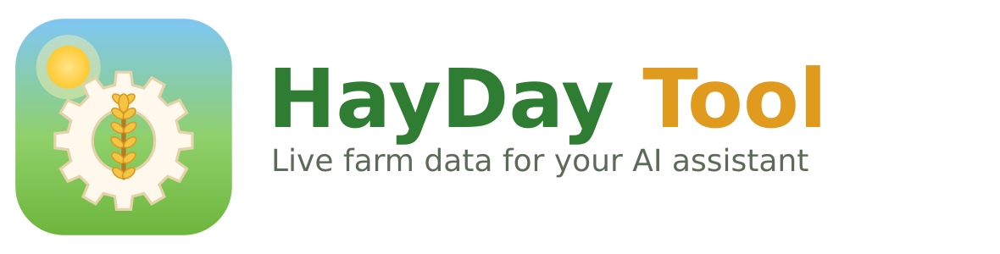

<p align="center">
  
</p>

# HayDay Tool

[](https://nodejs.org)
[](LICENSE)
[](index.html)

**A web app for HayDay players.** Live game data, a best-profit finder, level-unlock lookups, and a needed-goods checklist that tracks your barn and silo space as you build it. One self-contained HTML file — no build step, no backend, no install.

## What it does

- **Browse** every item (348 of them) — search by name or machine, filter by category, and sort by level, price, time, XP, or profit/hour.
- **Best Profit** — rank items by profit/hour, bounded by a level range and machine. "Best crop I can grow up to level 15?" is one tap.
- **Level Unlocks** — see exactly what opens up at a level, or everything available up to it.
- **Planner** — tell it what you want to make (e.g. "10 Cakes") and it expands every recipe down to the raw materials you need to gather — crops, tree/bush fruit, and animal products — totalled by barn and silo space, with a copy button and one-click "add raw materials to My List."
- **My List** — a needed-goods checklist. Add goods with amounts, tick them off as you collect them, and watch a running header show your **barn** and **silo** space (field crops count against the silo; everything else against the barn). It flags when you go over. One-tap **Copy** exports the whole list as clean text. Saved in your browser, so it's there next time.

## Run it

It's a single file. Any of these work:

- **Just open it** — double-click `index.html` (or drag it into a browser).
- **Host it free on GitHub Pages:**
  1. Push this repo to GitHub (it already lives at `biblestudytn26/HayDayTool`).
  2. Repo **Settings → Pages → Build and deployment → Source: Deploy from a branch**, pick `main` / root, **Save**.
  3. A minute later it's live at `https://biblestudytn26.github.io/HayDayTool/`.
- **Any static host** — Netlify, Cloudflare Pages, your own server: just drop `index.html` in.

## How the data works

The app reads live data from [hayday.info](https://hayday.info). That site doesn't send CORS headers, so a browser can't call it directly — the app relays the request through a public read-only proxy (with several fallbacks and a retry), then caches the result in your browser for an hour. Hit **Refresh** any time to pull the latest. Each item carries: machine, level, price, production time, XP, profit/hour and XP/hour.

Recipe data (ingredients and quantities per product, used by the Planner) is a separate thing: it ships in `data/recipes.js`, sourced from the [Hay Day Fandom Wiki](https://hayday.fandom.com) (via [drarvindc/hayday-tracker](https://github.com/drarvindc/hayday-tracker)). It's bundled, not fetched, so the Planner works even if the live feed is down.

## Also included: an MCP server

The repo also ships a small **Model Context Protocol server** (`server.js` + `lib/`) that exposes the same data — plus the checklist — as tools for AI assistants like Claude Desktop, Cursor, or VS Code. It's optional and completely separate from the web app.

<details>
<summary>MCP server setup</summary>

Requires Node.js 18+ (zero dependencies).

```bash
npm install
npm test        # optional
node server.js  # waits for an MCP client over stdio
```

Point a client at it, e.g. Claude Desktop's `claude_desktop_config.json`:

```json
{
  "mcpServers": {
    "hayday-data": {
      "command": "node",
      "args": ["server.js"],
      "cwd": "/absolute/path/to/HayDayTool"
    }
  }
}
```

Tools: `search_items`, `get_item`, `get_machines`, `get_by_machine`, `get_crops`,
`get_animals`, `get_level_unlocks`, `get_unlocks_upto`, `get_best_profit`,
`compare_profit`, `clear_cache`, plus the checklist tools (`list_add`,
`list_set_amount`, `list_check`, `list_remove`, `list_view`,
`list_set_capacity`, `list_clear`, `list_export`).

</details>

## Project layout

```
HayDayTool/
  index.html         # the web app (open this, or host it)
  manifest.webmanifest # PWA manifest (installable, home-screen icon)
  data/recipes.js    # bundled recipe data for the Planner (Hay Day Wiki)
  assets/            # logo + app icons (favicon, apple-touch, maskable)
  server.js          # optional MCP server for AI clients
  lib/               # data, cache, and checklist logic (shared by the MCP server)
  test/              # node --test smoke tests for the MCP server
  package.json
  CHANGELOG.md
  LICENSE            # MIT
```

## License

MIT — see [LICENSE](LICENSE).

## Legal notice

This project is an independent, read-only fan tool and is **not affiliated with, endorsed by, or connected to Supercell Oy**. HayDay is a trademark of Supercell Oy. All game data comes from publicly available community resources. This tool does not interact with the HayDay game client, its servers, or its APIs, and is provided for informational and educational purposes only.
